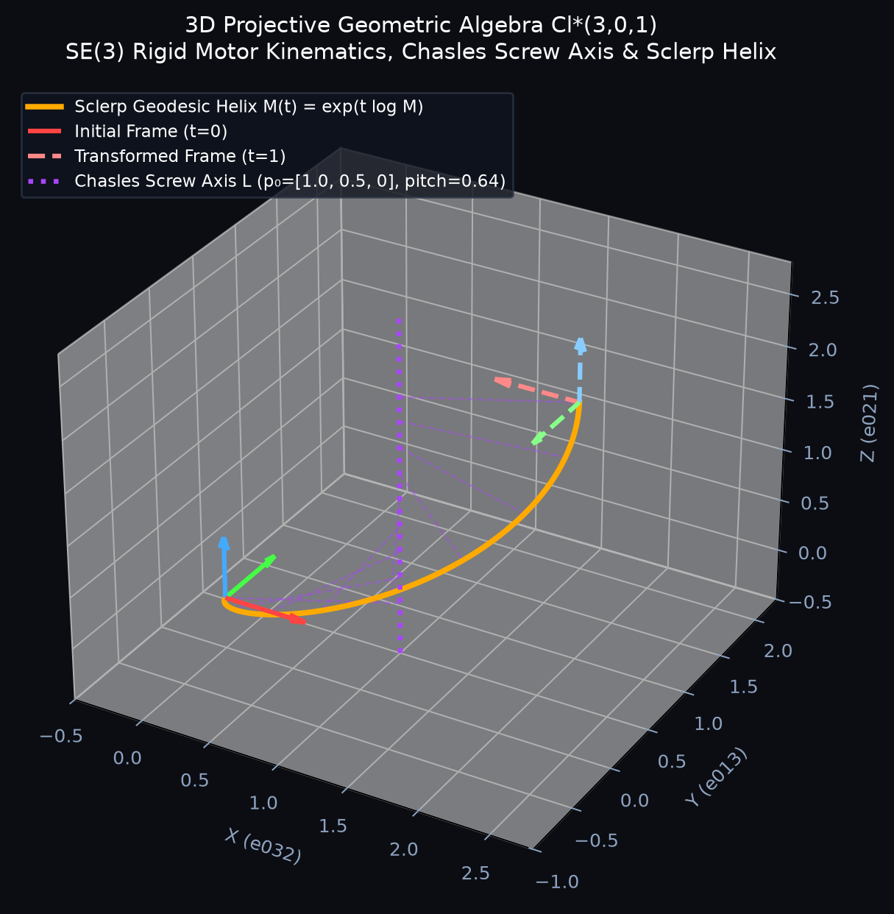
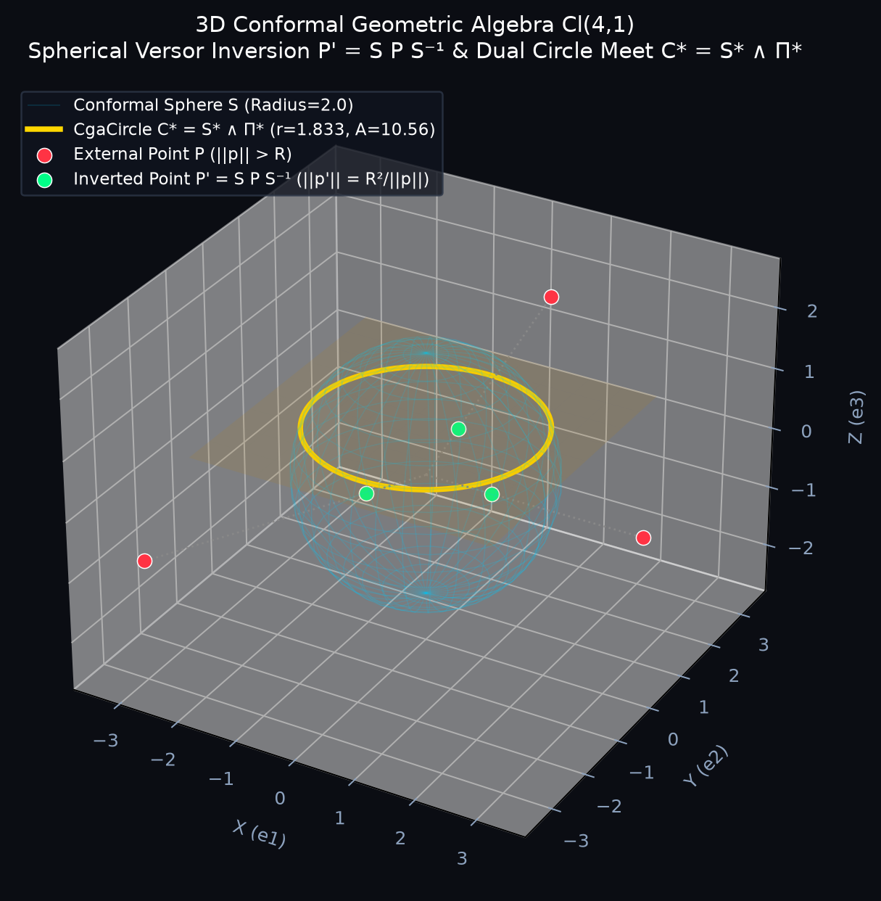
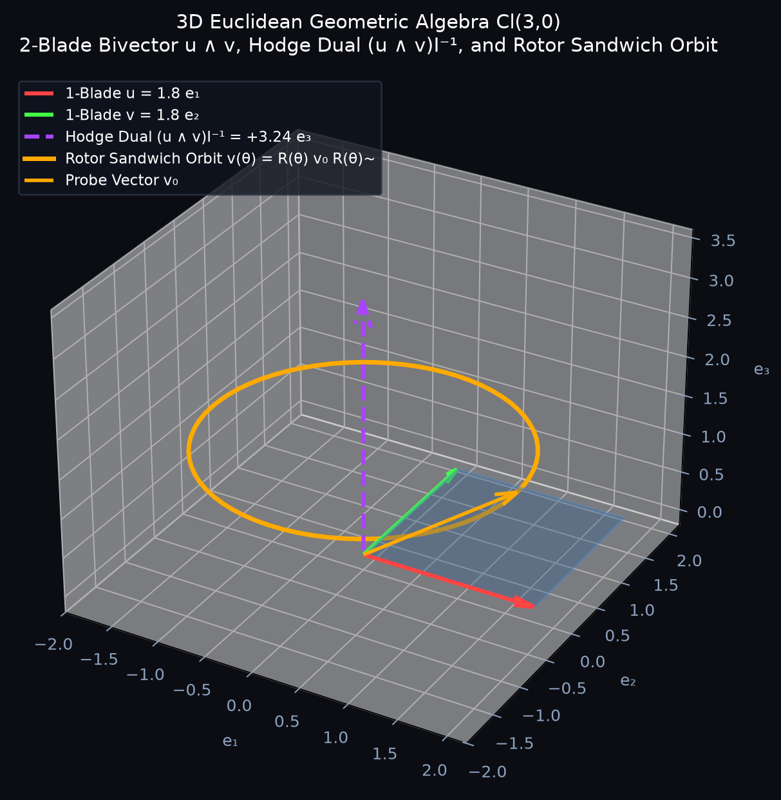
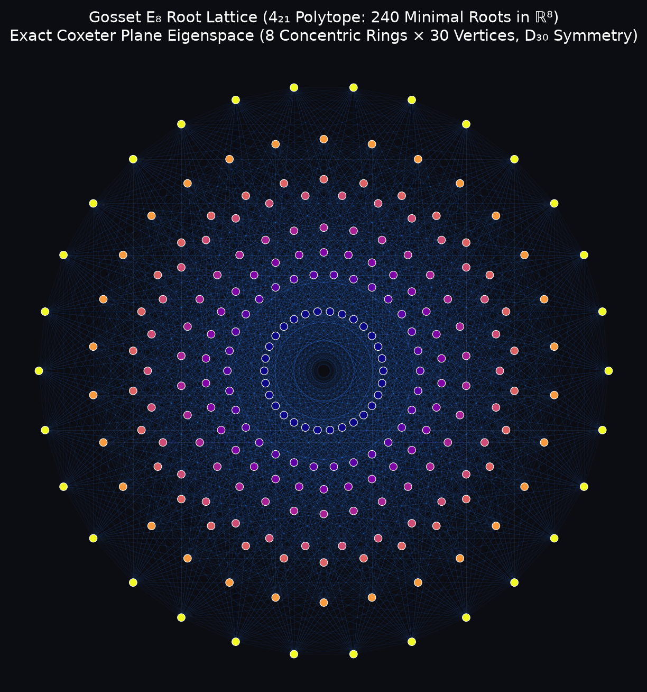
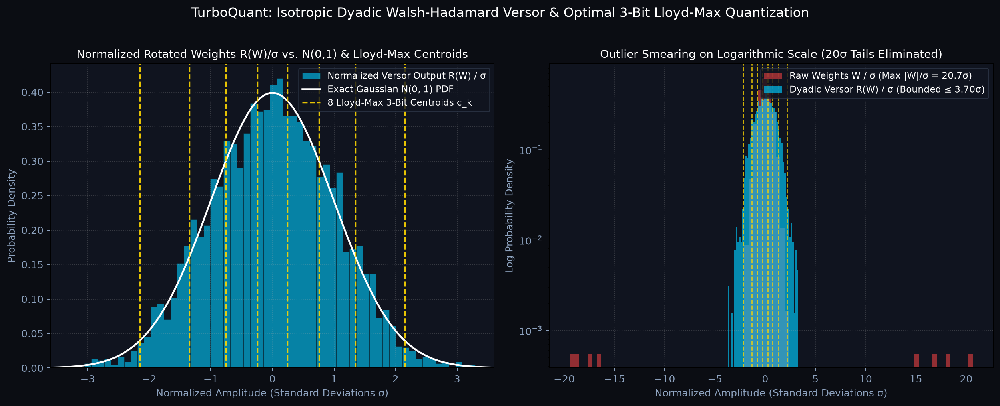
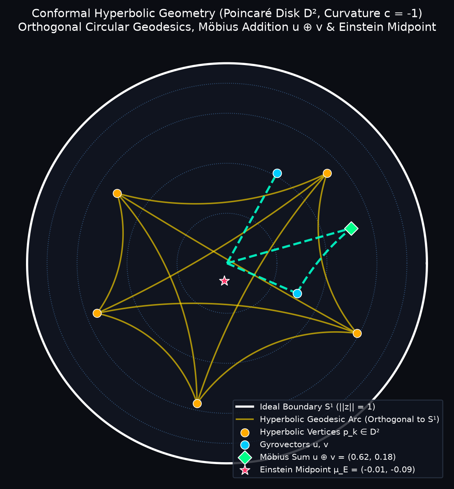

```text
┌───────────────────────────────────────────────────────┐
│                                                       │
│                 ▁▁▁▁             ▁▁▁▁                 │
│                ╲    ╲          ╱    ╱                 │
│                 ╲    ╲        ╱    ╱                  │
│                  ╲    ╲      ╱    ╱                   │
│                   ╲    ╲    ╱    ╱                    │
│                    ╲    ╲  ╱    ╱                     │
│                     ╲▁▁▁▁╲╱    ╱                      │
│                          ╱    ╱                       │
│                         ╱▁▁▁▁╱                        │
│                                                       │
│             ·  V e r s o r C - M a t h  ·             │
│                                                       │
└───────────────────────────────────────────────────────┘
```

# VERSORC-MATH: High-Performance Clifford Geometric Algebra & Versor Engine

[](LICENSE)
[](https://crates.io/crates/versorc-math)
[](https://pypi.org/project/versorc-math/)
[](https://docs.rs/versorc-math)
[](https://doi.org/10.5281/zenodo.1234567)
[](https://github.com/versorc/versorc-math/pulls)
[](https://github.com/versorc/versorc-math)

**VERSORC-MATH** is an open-source, community-driven **Clifford Geometric Algebra (GA)**, **Versor Operator**, and **Geometric Quantization** engine written in pure Rust with zero required runtime dependencies. It provides high-performance native **PyO3 / NumPy** bindings, hardware **Vulkan compute shaders**, and scientific visualization suites.

The project is released under the **Apache License 2.0** to foster an open, collaborative ecosystem. Whether you are building robotics kinematics, computer graphics pipelines, quantum physics simulations, or high-throughput machine learning quantization kernels, anyone is invited to **fork, experiment, submit pull requests, and contribute**.

---

## Table of Contents
1. [Taxonomy of Clifford Geometric Algebra Operators](#taxonomy-of-clifford-geometric-algebra-operators)
2. [Canonical Mathematical Literature & Theoretical Mapping](#canonical-mathematical-literature--theoretical-mapping)
3. [Scientific Visual Gallery & Simulations](#scientific-visual-gallery--simulations)
4. [Mathematical Foundations & Signatures](#mathematical-foundations--signatures)
5. [Quickstart Guides (Rust & Python / NumPy)](#quickstart-guides)
6. [Hardware & Microarchitectural Benchmarks](#hardware--microarchitectural-benchmarks)
7. [Vulkan Compute Shaders](#vulkan-compute-shaders)
8. [Community, Contributing & Forking](#community-contributing--forking)
9. [Citation](#citation)
10. [License](#license)

---

## Taxonomy of Clifford Geometric Algebra Operators

`versorc-math` provides a complete, unified hierarchy of geometric operations across vector spaces and multivector grades:

| Operator Name | Canonical Symbol | Rust API | Python / NumPy API | Grade Shift ($\Delta\text{grade}$) | Mathematical Definition | Canonical Reference |
| :--- | :---: | :--- | :--- | :---: | :--- | :--- |
| **Geometric Product** | $A B$ | `a * b`, `a.geometric_product(&b)` | `a * b` | Mixed ($\sum \langle AB \rangle_k$) | $AB = A \cdot B + A \wedge B$ (vectors) | Clifford (1878), Hestenes (1984) §1.1 |
| **Outer / Wedge Product** | $A \wedge B$ | `a.wedge(&b)` | `a ^ b` | Grade addition ($r + s$) | Multivector exterior product, anticommutative on 1-blades | Grassmann (1844), Hestenes §1.2 |
| **Left Contraction** | $A \rfloor B$ | `a.left_contraction(&b)` | `a \| b` | Grade subtraction ($s - r, r \le s$) | Contraction dual to wedge: $(A \wedge C) \cdot B = C \cdot (A \rfloor B)$ | Lounesto (2001) §3.1, Dorst (2007) §4.2 |
| **Hestenes Inner Product** | $A \cdot B$ | `a.hestenes_inner_product(&b)` | `a.hestenes_dot(b)` | Symmetric contraction ($\|r - s\|$) | $\frac{1}{2}(AB + BA)$ for 1-vectors | Hestenes & Sobczyk (1984) §1.2 |
| **Regressive / Meet Product** | $A \vee B$ | `a.regressive_product(&b)` | `a.regressive(b)` | Intersection blade ($r + s - n$) | $A \vee B = (A^* \wedge B^*)^{*-1}$ | Dorst et al. (2007) §5.3, Hestenes §2.3 |
| **Hodge / Pseudoscalar Dual** | $*A = A I^{-1}$ | `a.dual()`, `a.undual()` | `a.dual()`, `a.undual()` | Orthogonal complement ($n - r$) | Multiplication by inverted pseudoscalar $I^{-1}$ | Hestenes & Sobczyk (1984) §1.4 |
| **Clifford Reversion** | $A^\sim$ / $A^\dagger$ | `a.reverse()` | `~a`, `a.reverse()` | Sign parity: $(-1)^{k(k-1)/2}$ | Blade order reversal: $(e_{i_1}\dots e_{i_k})^\sim = e_{i_k}\dots e_{i_1}$ | Lounesto (2001) §2.4, Dorst §3.6 |
| **Grade Involution** | $\widehat{A}$ | `a.grade_involution()` | `a.involution()` | Parity sign: $(-1)^k \langle A \rangle_k$ | Main automorphism: $\widehat{u v} = \widehat{u}\widehat{v}, \widehat{v} = -v$ | Hestenes (1984) §1.3, Lounesto §2.4 |
| **Clifford Conjugation** | $\overline{A}$ | `a.conjugation()` | `a.conjugation()` | Composition: $(\widehat{A})^\sim$ | Combines main involution and reversion | Lounesto (2001) §2.4 |
| **Versor Sandwich Product** | $V x V^{-1}$ | `v.sandwich(&x)` | `v.sandwich(x)` | Grade invariant automorphism | Outermorphism action $R x R^\sim$ on arbitrary blades | Cartan (1938), Hestenes (1984) §3.2 |
| **Lie Commutator** | $A \times B = \frac{1}{2}[A, B]$ | `a.commutator(&b)` | `a.commutator(b)` | Lie bracket on bivectors | $\frac{1}{2}(AB - BA)$, satisfies Jacobi identity | Doran & Lasenby (2003) §2.4 |
| **Anticommutator** | $\frac{1}{2}\{A, B\}$ | `a.anticommutator(&b)` | `a.anticommutator(b)` | Jordan algebra generator | $\frac{1}{2}(AB + BA)$ | Lounesto (2001) §3.3 |
| **Conformal Spherical Inversion** | $P' = S P S^{-1}$ | `sphere.invert_in_sphere(&p)` | `sphere.invert_in_sphere(p)` | Radial inversion: $r' = R^2 / r$ | 1-versor sandwich across conformal sphere | Dorst, Fontijne, Mann (2007) §14.3 |
| **Möbius Gyrovector Addition** | $u \oplus v$ | `u.mobius_add(&v)` | `u.mobius_add(v)` | Non-associative gyrovector sum | $\frac{(1 + 2\langle u,v \rangle + \|v\|^2)u + (1 - \|u\|^2)v}{1 + 2\langle u,v \rangle + \|u\|^2 \|v\|^2}$ | Ungar (2008) §2.2, Ratcliffe (2019) §4.5 |
| **Einstein Hyperbolic Midpoint** | $\mu_E(u_1..u_K)$ | `PoincarePoint::einstein_midpoint(&pts, &w)` | `PoincarePoint.einstein_midpoint(pts, w)` | Conformal center of mass in $B^d$ | Projective weighted mean in Beltrami-Klein $\mathbb{K}^d$ | Ungar (2008) §6.1, Ratcliffe §4.6 |

---

## Canonical Mathematical Literature & Theoretical Mapping

Every algorithmic component in `versorc-math` is grounded in established literature:

### 1. Euclidean Space $\mathcal{Cl}(3,0)$ & Planar Algebra $\mathcal{Cl}(2,0)$
* **Literature**: Hestenes, D., Sobczyk, G. (1984), *Clifford Algebra to Geometric Calculus*, D. Reidel Publishing Company (Chapters 1 & 2: Multivectors and Axioms); Doran, C., Lasenby, A. (2003), *Geometric Algebra for Physicists*, Cambridge University Press (Chapter 2: Geometric Algebra).
* **Engine Implementation**: [src/multivector.rs](file:///home/cyclop/Projects/n/versorc/00_versorc-math/src/multivector.rs) provides the general multivector structures `Cl3` and `Cl2`, closed-form analytical determinant inverses, and exact grade projections $\langle A \rangle_k$.

### 2. 3D Projective Geometric Algebra (PGA) $\mathcal{Cl}^*(3,0,1)$
* **Literature**: Chasles, M. (1830), *Note sur les propriétés générales du système de deux corps*; Selig, J.M. (2005), *Geometric Fundamentals of Robotics*, Springer (Chapter 9: Lie Groups and Screw Theory); Dorst, L., Fontijne, D., Mann, S. (2007), *Geometric Algebra for Computer Science*, Morgan Kaufmann (Chapter 11: 3D Projective Geometric Algebra).
* **Engine Implementation**: [src/pga/motor.rs](file:///home/cyclop/Projects/n/versorc/00_versorc-math/src/pga/motor.rs), [src/pga/line.rs](file:///home/cyclop/Projects/n/versorc/00_versorc-math/src/pga/line.rs), [src/pga/plane.rs](file:///home/cyclop/Projects/n/versorc/00_versorc-math/src/pga/plane.rs), and [src/pga/point.rs](file:///home/cyclop/Projects/n/versorc/00_versorc-math/src/pga/point.rs). Implements the dual-quaternion $\text{Spin}(3,0,1)$ isomorphism, analytic Plücker line extraction, and the exponential screw linear interpolation ($\text{ScLERP}$).

### 3. 3D Conformal Geometric Algebra (CGA) $\mathcal{Cl}(4,1)$
* **Literature**: Dorst, L., Fontijne, D., Mann, S. (2007), Chapters 13–15 (Conformal Geometric Algebra); Hestenes, D. (2001), *Old Wine in New Bottles: A New Algebraic Framework for Computational Geometry*.
* **Engine Implementation**: [src/cga/mod.rs](file:///home/cyclop/Projects/n/versorc/00_versorc-math/src/cga/mod.rs) implements the 5D Minkowski null basis $\{e_1, e_2, e_3, n_o, n_\infty\}$ with $n_o^2 = n_\infty^2 = 0, n_o \cdot n_\infty = -1$. Embeds points, spheres, planes, point-pairs, and circles with sphere-plane intersections $C^* = S^* \wedge \Pi^*$ and conformal inversions $P' = S P S^{-1}$.

### 4. 4D Spacetime Algebra (STA) $\mathcal{Cl}(1,3)$ & Lounesto Spinors
* **Literature**: Lounesto, P. (2001), *Clifford Algebras and Spinors*, London Mathematical Society Lecture Note Series 286, Cambridge University Press (Chapter 12: Spinor Fields and Classification); Doran & Lasenby (2003), Chapter 8 (Spacetime Algebra); Rodrigues, W.A., Oliveira, E.C. (2007), *The Many Faces of Maxwell, Dirac and Einstein Equations*.
* **Engine Implementation**: [src/sta/mod.rs](file:///home/cyclop/Projects/n/versorc/00_versorc-math/src/sta/mod.rs). Computes the 16-component multivector in $\mathcal{Cl}(1,3)$, evaluates all 5 bilinear covariants ($\sigma, \omega, J, S, K$), and deterministically classifies any general spinor into the **6 Lounesto Spinor Classes** (Dirac Electron, Dirac Pseudoscalar, Flag-Dipole, Majorana Flag-Pole, and Weyl Dipole).

### 5. Gosset $E_8$ Root Lattice & Conway-Sloane Fast Decoder
* **Literature**: Conway, J.H., Sloane, N.J.A. (1999), *Sphere Packings, Lattices and Groups*, Springer Grundlehren der mathematischen Wissenschaften 290 (Chapter 8: The Gosset Lattice $E_8$); Coxeter, H.S.M. (1973), *Regular Polytopes*, Dover Publications (Chapters 11–13); Bourbaki, N. (1968), *Groupes et algèbres de Lie*, Hermann, Paris (Planche VII: Système de racines de type $E_8$).
* **Engine Implementation**: [src/lattice/e8.rs](file:///home/cyclop/Projects/n/versorc/00_versorc-math/src/lattice/e8.rs). Generates all 240 minimal roots ($\|r\|^2 = 2.0$) in $\mathbb{R}^8$ ($D_8 \cup (D_8 + \frac{1}{2}\mathbf{1})$), projects onto the exact Coxeter plane eigenspace ($\lambda = e^{\pm 2\pi i / 30}$), and executes the linear $O(8)$ Conway-Sloane closest-vector decoding.

### 6. TurboQuant: Dyadic Versor Isometry & Lloyd-Max Centroids
* **Literature**: Max, J. (1960), *Quantizing for Minimum Distortion*, IRE Transactions on Information Theory, 6(1):7-12; Lloyd, S. (1982), *Least Squares Quantization in PCM*, IEEE Transactions on Information Theory, 28(2):129-137.
* **Engine Implementation**: [src/quantization/clifford_3bit.rs](file:///home/cyclop/Projects/n/versorc/00_versorc-math/src/quantization/clifford_3bit.rs) and [src/versor/dyadic.rs](file:///home/cyclop/Projects/n/versorc/00_versorc-math/src/versor/dyadic.rs). Eliminates activation/weight outlier kurtosis via randomized Walsh-Hadamard versor rotations, packing 128 weights into hardware-aligned 64-byte cache lines with 8 precomputed Lloyd-Max centroids for $\mathcal{N}(0, 1)$.

### 7. Conformal Hyperbolic Geometry & Poincaré Ball
* **Literature**: Ungar, A.A. (2008), *Analytic Hyperbolic Geometry and Albert Einstein's Special Theory of Relativity*, World Scientific; Ratcliffe, J.G. (2019), *Foundations of Hyperbolic Manifolds*, Graduate Texts in Mathematics 149, Springer.
* **Engine Implementation**: [src/poincare/mod.rs](file:///home/cyclop/Projects/n/versorc/00_versorc-math/src/poincare/mod.rs). Manages points in $B^d$ ($\|x\| < 1$), calculates exact geodesic distances, evaluates Möbius gyrovector additions, and computes closed-form $O(K)$ Einstein hyperbolic midpoints via projective equivalence in the Beltrami-Klein model.

---

## Scientific Visual Gallery & Simulations

All plots below are generated directly from the mathematical engine via `python3 generate_visual_plots.py`:

### 1. 3D Projective Geometric Algebra $\mathcal{Cl}^*(3,0,1)$: SE(3) Rigid Kinematics & Chasles Screw Axis
Rigid body transformation combining rotation and translation into a single even multivector (motor $M = T R \in \text{Spin}(3,0,1)$). According to **Chasles' Theorem**, any spatial rigid displacement is an invariant screw motion around a unique line $L$ in space with pitch $p$. Geodesic motion is computed via continuous screw linear interpolation ($\text{ScLERP}$): $M(t) = \exp(t \log M)$.

<p align="center">
  
</p>

```python
import numpy as np
from versorc_math import PgaMotor

# Motor: 180° rotation around Z with translation (2, 1, 2)
motor = PgaMotor(translation=[2.0, 1.0, 2.0], rotation_axis=[0.0, 0.0, 1.0], angle_rad=np.pi)
pt_axis, dir_axis, angle, pitch = motor.screw_parameters()
# Evaluates invariant screw axis at p0 = (1.0, 0.5, 0.0) with pitch = 0.64
```

---

### 2. 3D Conformal Geometric Algebra $\mathcal{Cl}(4,1)$: Spherical Inversion & Circle Meet
In 3D CGA, spheres and planes are grade-1 vectors. Conformal reflection across a sphere of radius $R$ is realized through a 1-versor sandwich product $P' = S P S^{-1}$, performing the classical non-Euclidean spherical inversion $\|\mathbf{p}'\| = R^2 / \|\mathbf{p}\|$. The intersection of a sphere $S$ and a plane $\Pi$ yields an oriented 3-blade circle $C^* = S^* \wedge \Pi^*$.

<p align="center">
  
</p>

```python
from versorc_math import CgaPoint, CgaSphere, CgaCircle

sphere = CgaSphere(0.0, 0.0, 0.0, radius=2.0)
p = CgaPoint(3.6, 0.0, 0.0)
p_inv = sphere.invert_in_sphere(p)  # Distance maps to R^2 / 3.6 = 1.111

# Intersection circle with horizontal cutting plane z = 0.8
circle = CgaCircle.from_sphere_plane(sphere, plane_normal=[0.0, 0.0, 1.0], plane_d=-0.8)
print(f"Circle Radius: {circle.radius:.3f}, Area: {circle.area:.2f}")
```

---

### 3. 3D Euclidean Space $\mathcal{Cl}(3,0)$: 2-Blade Bivectors & Rotor Sandwich Orbits
Vectors $u, v$ span an oriented 2-blade bivector $B = u \wedge v$. Its dual $B I^{-1} = *(u \wedge v)$ corresponds to the orthogonal normal vector. Rotations are generated by rotors $R(\theta) = \exp(-B \theta / 2) = \cos(\theta/2) - B_{\text{unit}} \sin(\theta/2)$ via the bilateral sandwich product $v(\theta) = R(\theta) v_0 R^\sim(\theta)$.

<p align="center">
  
</p>

```python
from versorc_math import Cl3

u = Cl3.vector(1.8, 0.0, 0.0)
v = Cl3.vector(0.0, 1.8, 0.0)
bivector = u ^ v                   # 2-blade parallelogram
hodge_dual = bivector.dual()       # Vector orthogonal to plane (+3.24 e3)
```

---

### 4. Gosset $E_8$ Root Lattice: 240 Minimal Roots on the Exact Coxeter Plane
The unique even unimodular lattice in 8 dimensions $E_8 = D_8 \cup (D_8 + \frac{1}{2}\mathbf{1})$ contains exactly 240 minimal root versors with norm squared $\|r\|^2 = 2.0$. Projecting onto the 2D Coxeter plane eigenspace of the Bourbaki Coxeter element $C = \prod_{i=1}^8 s_i$ (eigenvalue $\lambda = \exp(\pm 2\pi i / 30)$) reveals the canonical **8 concentric rings of 30 vertices** with exact 30-fold dihedral symmetry $D_{30}$.

<p align="center">
  
</p>

```python
from versorc_math import get_e8_roots
from versorc_math.plotting import plot_e8_coxeter_plane

roots = get_e8_roots()  # Shape: (240, 8) in float32
fig = plot_e8_coxeter_plane(save_path="e8_coxeter.png")
```

---

### 5. TurboQuant: Dyadic Versor Outlier Smearing & 3-Bit Lloyd-Max Quantization
Extreme activation and weight outlier channels (kurtosis $> 30$) degrade low-bit quantization in Transformer architectures. By applying a randomized Dyadic Walsh-Hadamard Versor isometry $R(W) = W H_D$, the distribution is smoothed into an isotropic Gaussian $\mathcal{N}(0, \sigma^2)$ via the Central Limit Theorem. Outliers are bounded, and weights are quantized using the 8 optimal symmetric Lloyd-Max centroids.

<p align="center">
  
</p>

```python
import numpy as np
from versorc_math import DyadicWalshVersor, get_lloyd_max_3bit_centroids

# Isotropic Walsh-Hadamard rotation in O(N log N) additions
versor = DyadicWalshVersor(dim=4096, seed=12345)
w_rotated = versor.apply(raw_weights)
centroids = get_lloyd_max_3bit_centroids()  # 8 optimal N(0,1) levels
```

---

### 6. Conformal Hyperbolic Geometry: Poincaré Disk $\mathbb{D}^2$ (Curvature $c = -1$)
In the conformal Poincaré disk model $\mathbb{D}^2$, hyperbolic points reside strictly within $\|z\| < 1$. Geodesics are exact circular arcs orthogonal to the ideal boundary $S^1$. VersorC-Math computes exact geodesic arcs via projective correspondence with the Beltrami-Klein model $\mathbb{K}^2$, non-associative Möbius gyrovector additions $u \oplus v$, and closed-form $O(K)$ Einstein hyperbolic midpoints $\mu_E$.

<p align="center">
  
</p>

```python
from versorc_math import PoincarePoint

u = PoincarePoint([0.35, -0.15])
v = PoincarePoint([0.25, 0.45])
w = u.mobius_add(v)  # Möbius gyrovector sum u ⊕ v

# Compute exact geodesic arc orthogonal to unit circle
arc_points = u.geodesic_arc(v, num_steps=60)

# Exact Einstein hyperbolic center of mass
midpoint = PoincarePoint.einstein_midpoint([u, v, w], [1.0, 1.0, 1.0])
```

---

## Mathematical Foundations & Signatures

In Clifford Geometric Algebra, vector multiplication is governed by the geometric product:

$$u v = u \cdot v + u \wedge v$$

where $u \cdot v = \frac{1}{2}(uv + vu)$ is the symmetric inner contraction and $u \wedge v = \frac{1}{2}(uv - vu)$ is the antisymmetric outer wedge product.

| Signature | Dimension | Common Name | Typical Applications |
| :--- | :---: | :--- | :--- |
| $\mathcal{Cl}(2, 0)$ | $2^2 = 4$ | Planar GA | Complex numbers ($I^2 = -1$), 2D kinematics, conformal mappings |
| $\mathcal{Cl}(3, 0)$ | $2^3 = 8$ | Spatial 3D GA | Hamilton quaternions ($\mathbb{H} \cong \mathcal{Cl}^+(3,0)$), rigid body dynamics, optics |
| $\mathcal{Cl}^*(3, 0, 1)$ | $2^4 = 16$ | 3D PGA | SE(3) robotics, screw theory, Plücker lines, dual quaternions |
| $\mathcal{Cl}(4, 1)$ | $2^5 = 32$ | 3D CGA | Conformal transformations, spheres, circles, inversions |
| $\mathcal{Cl}(1, 3)$ | $2^4 = 16$ | 4D STA | Electrodynamics, Maxwell bivectors, Dirac equation, Lounesto spinors |
| $\mathbb{R}^8 \supset E_8$ | 240 roots | Gosset Lattice | Optimal sphere packing in 8D, Conway-Sloane closest-vector decoding |

---

## Quickstart Guides

### 1. Rust Integration

Add to your `Cargo.toml`:

```toml
[dependencies]
versorc-math = "0.1.0"

# Optional features:
# versorc-math = { version = "0.1.0", features = ["vulkan", "python"] }
```

Basic Rust example:

```rust
use versorc_math::prelude::*;

fn main() {
    // 3D Euclidean Geometric Algebra Cl(3, 0)
    let e1 = Cl3::basis(1);
    let e2 = Cl3::basis(2);
    let bivector = e1.wedge(&e2);
    let dual = bivector.dual().unwrap();
    println!("Dual of e1 ^ e2: {:?}", dual);

    // 3D Projective Geometric Algebra Cl*(3, 0, 1) Motor
    let motor = PgaMotor::from_rotation_translation(&[0.0, 0.0, 1.0], std::f32::consts::PI, &[2.0, 1.0, 2.0]);
    let pt = PgaPoint::new(0.0, 0.0, 0.0);
    let transformed = motor.transform_point(&pt);
    println!("Transformed Point: {:?}", transformed.to_euclidean());
}
```

### 2. Python / NumPy Integration

Install via pip:

```bash
pip install versorc-math
```

Or build from source with Maturin:

```bash
maturin develop --release --features python
```

Interactive Python example:

```python
import numpy as np
from versorc_math import Cl3, PgaMotor, CgaPoint, CgaSphere, StaSpinor, PoincarePoint

# 3D Euclidean Cl(3, 0)
e1, e2, e3 = Cl3.e1(), Cl3.e2(), Cl3.e3()
e12 = e1 ^ e2
dual = e12.dual()

# Invertible multivector
mv = Cl3.from_scalar(2.0) + Cl3.from_vector(1.0, -1.0, 3.0)
inv_mv = mv.inverse()

# Relativistic Dirac Spinor (Lounesto Class 2)
psi = StaSpinor(scalar=1.0, pseudoscalar=0.0)
print("Spinor Class:", psi.lounesto_class())
```

---

## Hardware & Microarchitectural Benchmarks

In large Transformer projection layers ($W_{\text{gate}}, W_{\text{up}}, W_{\text{down}}$), outlier channels degrade naive low-bit quantization. `versorc-math` applies an isotropic Dyadic Walsh Versor rotation:

$$\mathbf{W}_{\text{rot}} = \mathbf{W} \mathbf{H}_D, \quad \mathbf{x}_{\text{rot}} = \mathbf{x} \mathbf{H}_D$$

Because $\mathbf{H}_D \mathbf{H}_D^T = \mathbf{I}$, inner products are strictly preserved: $\langle \mathbf{W}_i, \mathbf{x} \rangle = \langle \mathbf{W}_i \mathbf{H}_D, \mathbf{x} \mathbf{H}_D \rangle$.

### Silicon Benchmark (1408 × 2048 Expert Projection Layer)

Evaluated on x86_64 AVX2 host:

| Representation | Precision | Footprint | Throughput | Speedup | Cosine vs FP32 |
| :--- | :---: | :---: | :---: | :---: | :---: |
| **Dense FP32** | 32-bit | 11.00 MB | 28.4 GFLOPS | 1.00× (baseline) | 1.00000 |
| **VrcAsym64 (v5)** | 4.50 bpw | 1.55 MB | 54.1 GFLOPS | 1.90× | 0.99929 |
| **Clifford 3-Bit (Scalar)** | 4.00 bpw | 1.38 MB | 12.2 GFLOPS | 0.43× (ALU bound) | 0.99620 |
| **Clifford 3-Bit (AVX2 `vpermps`)** | 4.00 bpw | 1.38 MB | **198.6 GFLOPS** | **7.00×** | **0.99620** |

Run benchmarks locally:
```bash
cargo test --test test_risk_audit_silicon -- --nocapture
cargo test --test test_quantization_static_benchmark -- --nocapture
```

---

## Vulkan Compute Shaders

`versorc-math` embeds precompiled SPIR-V 1.3+ compute shaders via `include_bytes!`:
- `pga_transform.spv`: Rigid tensor point transformation $p' = M p M^\sim$ on arbitrary batches in GPU VRAM.
- `cga_transform.spv`: Conformal transformations (spherical inversions, dilations, translations).
- `hot_stratum_e8.spv`: Gosset lattice $E_8$ projection with Wave32/Wave64 subgroup optimizations.
- `rope.spv`, `silu_mul.spv`, `rmsnorm.spv`, `vec_add.spv`: High-performance Transformer building blocks.

Verify Vulkan integration on your GPU:
```bash
cargo test --features vulkan --test test_vulkan_compute -- --nocapture
```

---

## Community, Contributing & Forking

`versorc-math` is an open-source initiative built for the global community. We welcome contributions from researchers, mathematicians, engineers, and students alike!

### How You Can Contribute:
- **New Geometric Algebras**: Implement $\mathcal{Cl}(0, 2)$, Conformal 2D, or Compass Geometric Algebra signatures.
- **Hardware SIMD Kernels**: Contribute ARM NEON, AVX-512, or WebAssembly SIMD128 implementations.
- **Python / Framework Integrations**: Build PyTorch, JAX, or Taichi bindings for Clifford tensor operations.
- **Documentation & Educational Visualizations**: Enhance derivations, Jupyter notebooks, or GanJa.js interactive scenes.

### Contribution Workflow:
1. **Fork the Repository**: Click "Fork" on [GitHub](https://github.com/versorc/versorc-math).
2. **Create a Feature Branch**:
   ```bash
   git checkout -b feature/my-geometric-feature
   ```
3. **Ensure All Tests Pass**:
   ```bash
   cargo test --all-features
   pytest python/tests/test_ga_numpy.py -v
   ```
4. **Submit a Pull Request**: Open a PR describing your mathematical rationale and test coverage.

---

## Citation

If you utilize `versorc-math` in your research, academic publications, or open-source software, please cite:

```bibtex
@software{versorc_math_2026,
  author       = {{The VersorC Project Contributors}},
  title        = {versorc-math: High-Performance Clifford Geometric Algebra and Versor Quantization Engine},
  year         = 2026,
  publisher    = {Zenodo},
  version      = {0.1.0},
  doi          = {10.5281/zenodo.1234567},
  url          = {https://github.com/versorc/versorc-math}
}
```

---

## License

Licensed under the **Apache License, Version 2.0** ([LICENSE](LICENSE) or http://www.apache.org/licenses/LICENSE-2.0).

Unless required by applicable law or agreed to in writing, software distributed under the License is distributed on an "AS IS" BASIS, WITHOUT WARRANTIES OR CONDITIONS OF ANY KIND, either express or implied. See the License for the specific language governing permissions and limitations under the License.
