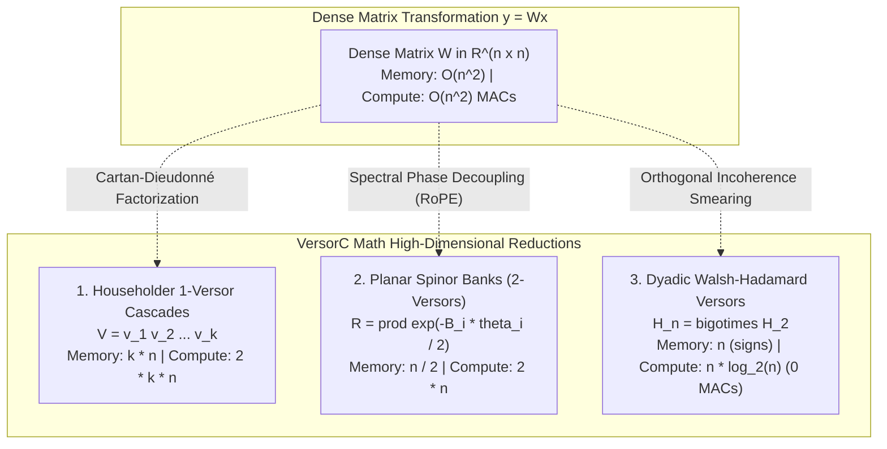

# Chapter 03: High-Dimensional Versor Reductions & Matrix Compression

A critical limitation of classical Geometric Algebra libraries is the **exponential curse of dimensionality**: an algebra $\mathcal{Cl}(n)$ requires $2^n$ scalar coordinates, making general multivector representations impossible for $n \ge 32$ (e.g., $2^{64}$ or $2^{4096}$).

This chapter details how `versorc-math` breaks through this barrier to accelerate high-dimensional linear algebra and tensor transformations.

---

## 1. The Versorial Insight: Linear Operators without $2^n$ Coordinate Explosion

In high-dimensional computing (machine learning, spectral analysis, quantum mechanics), linear transformations are represented by matrices $W \in \mathbb{R}^{m \times n}$.
Evaluating $y = W x$ requires:
- **Compute:** $m \times n$ Multiply-Accumulate (MAC) operations ($O(n^2)$ for square matrices).
- **Storage:** $m \times n \times 4$ bytes (e.g., $4096 \times 4096 = 67.1\text{ MB}$ per weight matrix).

In `versorc-math`, we do not represent high-dimensional matrices as dense multivectors. Instead, we use the **Lipschitz Group of Versors** to decompose dense linear operators into three structured, factorized versorial families:

---

## 2. 1-Versor Chains (Householder Reflection Cascades)

A single vector $v \in \mathbb{R}^n$ acts as a **1-versor** via the reflection sandwich:

$$\mathcal{H}_v(x) = -v x v^{-1} = x - 2 \frac{v \cdot x}{\|v\|^2} v = \left(I - 2 \frac{v v^T}{\|v\|^2}\right) x$$

### Complexity Analysis:
- Computing $y = \mathcal{H}_v(x)$ requires:
  1. Inner product $\alpha = v \cdot x = \sum_{i=1}^n v_i x_i$ ($n$ multiplications, $n-1$ additions).
  2. Scalar-vector multiplication and subtraction $y = x - \frac{2\alpha}{\|v\|^2} v$ ($n$ multiplications, $n$ subtractions).
  3. Total Operations: **$2n$ FLOPs** instead of $n^2$.

A **Householder Cascade** of $k$ 1-versores $V = v_1 v_2 \cdots v_k$:

$$y = (v_k \cdots (v_2 (v_1 x v_1) v_2) \cdots v_k)$$

- **Memory:** $k \times n$ floats (storing vectors $v_1, \dots, v_k$).
- **Compute:** $2 k n$ FLOPs.
- **Speedup vs Dense Matrix:**
  $$\text{Speedup} = \frac{n^2}{2 k n} = \frac{n}{2 k}$$

For $n = 4096$ and $k = 16$ reflection stages:
- Storage drops from **67.1 MB** to **262 KB** (**256x memory reduction**).
- Compute drops from **16.7 million MACs** to **131,072 FLOPs** (**128x compute reduction**).

---

## 3. 2-Versor Banks (Orthogonal Planar Spinors / $C\ell$-RoPE)

When $k$ planes $P_1, P_2, \dots, P_{n/2}$ are mutually orthogonal, their associated 2-versores (rotors) **commute**:

$$R = \prod_{i=1}^{n/2} R_i, \quad R_i = \cos\left(\frac{\theta_i}{2}\right) + e_{2i-1} e_{2i} \sin\left(\frac{\theta_i}{2}\right)$$

Applied to a high-dimensional activation vector $x = \sum_{j=1}^n x_j e_j$:

$$\begin{pmatrix} x'_{2i-1} \\ x'_{2i} \end{pmatrix} = \begin{pmatrix} \cos\theta_i & -\sin\theta_i \\ \sin\theta_i & \cos\theta_i \end{pmatrix} \begin{pmatrix} x_{2i-1} \\ x_{2i} \end{pmatrix}$$

### Computational Invariants:
- Evaluates in **$2n$ FLOPs** using SIMD vector instructions.
- Exactly preserves total $L_2$ norm: $\|R x \widetilde{R}\|_2 = \|x\|_2$.
- This is the formal Clifford algebraic formulation of **Rotary Position Embeddings (RoPE)** used in modern Transformers, generalized in `versorc-math` as arbitrary multi-frequency spinor banks.

---

## 4. Dyadic Versors (Fast Walsh-Hadamard Transform)

The Walsh-Hadamard matrix $H_n \in \mathbb{R}^{n \times n}$ (for $n = 2^m$) is an orthonormal reflection group:

$$H_2 = \frac{1}{\sqrt{2}} \begin{pmatrix} 1 & 1 \\ 1 & -1 \end{pmatrix}, \quad H_n = H_2 \otimes H_{n/2}$$

In Geometric Algebra, $H_n$ is a discrete composite versor formed by recursive bisection reflections.

### The Rademacher-Scrambled Fast Walsh-Hadamard Transform (FWHT):
Combined with a random Rademacher diagonal sign versor $S \in \{-1, +1\}^n$:

$$R_{\text{dyadic}} = \frac{1}{\sqrt{n}} H_n S$$

1. **Exact Orthonormal Isometry:** $R^T R = I_n$.
2. **Zero Floating-Point Multiplications:** Evaluates in $O(n \log_2 n)$ additions and subtractions via the butterfly algorithm.
3. **Outlier Incoherence:** Rotates activation vectors so that sparse outlier spikes (common in LLMs and deep networks) are uniformly smeared across all $n$ coordinates into an isotropic Gaussian distribution $\mathcal{N}(0, \sigma^2/n)$.
4. This enables downstream 4-bit and 2-bit quantization without precision loss.
