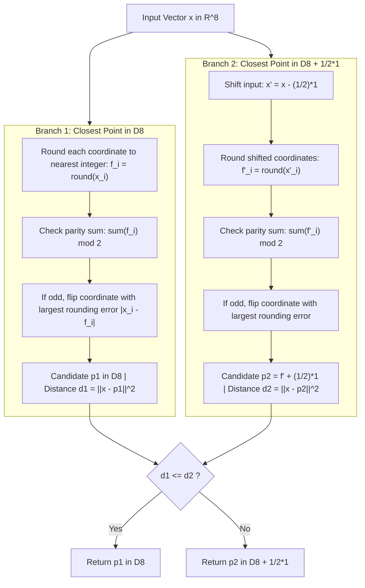

# Chapter 04: The Gosset $E_8$ Lattice & Conway-Sloane Decoding

This chapter formalizes the 8-dimensional Gosset lattice $E_8$, its 240 minimal root versors, and the $O(n)$ Conway & Sloane fast closest-point decoding algorithm implemented in `versorc-math`.

---

## 1. Geometric Definition of the $E_8$ Lattice

The $E_8$ lattice is the unique even, unimodular lattice in dimension 8. It achieves the densest possible sphere packing in 8-dimensional Euclidean space $\mathbb{R}^8$ (proven by Maryna Viazovska, 2016).

In standard coordinate geometry, the $E_8$ lattice can be expressed as the union of two cosets of the checkerboard lattice $D_8$:

$$E_8 = D_8 \cup \left(D_8 + \frac{1}{2} \mathbf{1}\right)$$

where:
- $\mathbf{1} = (1, 1, 1, 1, 1, 1, 1, 1)^T \in \mathbb{R}^8$.
- $D_8$ consists of all vectors $x \in \mathbb{Z}^8$ such that the sum of coordinates is **even**:
  $$D_8 = \left\{ x = (x_1, \dots, x_8) \in \mathbb{Z}^8 \;:\; \sum_{i=1}^8 x_i \equiv 0 \pmod 2 \right\}$$
- $D_8 + \frac{1}{2} \mathbf{1}$ consists of all half-integer vectors $y \in \left(\mathbb{Z} + \frac{1}{2}\right)^8$ such that the sum of coordinates is **even**:
  $$D_8 + \frac{1}{2} \mathbf{1} = \left\{ y = \left(y_1 + \frac{1}{2}, \dots, y_8 + \frac{1}{2}\right) \;:\; y_i \in \mathbb{Z}, \; \sum_{i=1}^8 \left(y_i + \frac{1}{2}\right) \equiv 0 \pmod 2 \right\}$$

---

## 2. The 240 Minimal Roots of $E_8$

The minimal non-zero vectors (roots) of $E_8$ all have squared Euclidean norm:

$$\|r\|^2 = \sum_{i=1}^8 r_i^2 = 2.0 \quad \Longrightarrow \quad \|r\| = \sqrt{2} \approx 1.41421356$$

There are exactly **240 minimal root vectors**, split into two canonical groups:

### Group 1: 112 Integer Roots in $D_8$
All permutations of vectors with two non-zero coordinates equal to $\pm 1$:
$$(\pm 1, \pm 1, 0, 0, 0, 0, 0, 0)$$
- Number of coordinate pairs: $\binom{8}{2} = 28$.
- Number of sign combinations per pair: $2^2 = 4$.
- Total: $28 \times 4 = \mathbf{112}$ roots.
- Norm squared: $(\pm 1)^2 + (\pm 1)^2 = 1 + 1 = 2$.

### Group 2: 128 Half-Integer Roots in $D_8 + \frac{1}{2}\mathbf{1}$
Vectors with all coordinates equal to $\pm \frac{1}{2}$, subject to having an **even number of minus signs**:
$$\left(\pm \frac{1}{2}, \pm \frac{1}{2}, \pm \frac{1}{2}, \pm \frac{1}{2}, \pm \frac{1}{2}, \pm \frac{1}{2}, \pm \frac{1}{2}, \pm \frac{1}{2}\right) \quad \text{with } \prod_{i=1}^8 \operatorname{sgn}(r_i) = +1$$
- Total sign combinations: $2^8 = 256$.
- Even parity constraint: exactly half = $\frac{256}{2} = \mathbf{128}$ roots.
- Norm squared: $8 \times \left(\frac{1}{2}\right)^2 = 8 \times \frac{1}{4} = 2$.

$$\text{Total Roots} = 112 + 128 = \mathbf{240}$$

---

## 3. Conway & Sloane Fast Decoding Algorithm

Finding the closest lattice point in an arbitrary lattice is NP-hard. However, Conway and Sloane (1982) discovered that for $E_8$, the closest point can be determined in **strictly linear time $O(n) = O(8)$**:

### Algorithmic Contract:
- **Complexity:** Exactly 16 roundings, 16 distance checks, and 2 argmax lookups. Zero iterative search.
- **Optimality:** Mathematically proven to find the global nearest lattice point in $E_8$.
- **Application:** Used in `versorc-math` for vector quantization (mapping continuous 8-dimensional weight vectors directly onto the Gosset lattice after versor rotation).
